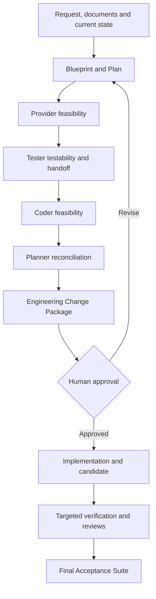

# Planner, Provider, Tester, Coder, and Replanning Workflow

Status: **pre-implementation normative design**

## Purpose

This document defines how architecture, technology facts, testability, implementation, and failure recovery interact without allowing one role to silently compensate for another role's error.

## Normal development flow



Provider feasibility and tester/coder feasibility are not approvals of product intent. They are pre-approval checks that the draft design can actually be implemented and verified under the stated constraints. Planner reconciles their findings before the Engineering Change Package becomes approval-ready.

## Planner responsibility

Planner creates/revises the ProjectBlueprint and owns architectural intent, including:

- repository/module layout;
- public interfaces and integration boundaries;
- provider/capability requirements;
- deployment/test/runtime environment requirements;
- implementation scope;
- verification requirements;
- architectural constraints and assumptions.

Planner must not prescribe provider-internal commands unless the exact command itself is a genuine user/project requirement.

## Provider responsibility

Provider supplies technology facts:

- available capabilities;
- required parameters;
- supported compatibility combinations;
- bootstrap dependencies;
- environment requirements;
- acceptance contract;
- domain action contract;
- permissions/privilege characteristics;
- deterministic failure classification.

Provider does not redesign the project and does not silently substitute a different deployment target.

## Tester responsibility

Tester checks whether planned behavior can be verified and whether acceptance criteria are observable.

Tester may reject a specific plan element as untestable or ambiguous. The rejection must identify:

- affected plan/blueprint element;
- reason;
- missing observable behavior or evidence requirement;
- affected tests;
- unaffected plan areas when known.

Tester should create concrete test specifications early enough that Coder understands the required observable behavior. Blueprint owns the traceable `VER-*` obligations; Tester owns concrete cases and evidence strategy. Coder receives 100% of applicable requirements/acceptance criteria plus approximately 70% of concrete test information as a development-facing handoff; approximately 30% is retained from Coder context for independent verification. The split is an engineering target rather than a mechanical file count. See `role-contracts-and-test-handoff.md`.

## Coder responsibility

Coder implements the approved architecture. Before substantial implementation, coder checks feasibility.

Coder must not silently replace an architectural choice when it proves infeasible. Instead coder emits a structured replan request identifying:

- affected blueprint/plan element;
- technical reason;
- supporting evidence;
- affected scope;
- unaffected scope where known;
- constraints that still must be preserved.

Example:

```yaml
type: plan_feasibility_failure
plan_element: PLAN-003
reason: selected dependency cannot provide required interface on target platform
affected_scope:
  - component_a
unaffected_scope:
  - component_b
constraints_preserved:
  - target platform remains fixed
```

## Targeted replanning

A feasibility failure routes to targeted replanning rather than discarding the whole project plan.

```text
IMPLEMENTING / PREFLIGHT
        |
        | infeasible element
        v
REPLAN_REQUIRED
        |
        v
Planner receives original inputs + approved blueprint + failure evidence
        |
        v
Revised blueprint/plan revision
        |
        v
Provider / tester / coder feasibility checks for affected dependencies
        |
        v
Required human approval of the revised Engineering Change Package
        |
        v
Resume implementation
```

Artifacts must carry dependency relationships so invalidation can be scoped. A changed architecture element invalidates artifacts that depend on it, not unrelated artifacts solely because some part of the plan changed.

Conceptual dependency chain:

```text
Requirement
    |
    v
Blueprint element
    |
    +--> Test specification
    |
    +--> Implementation
             |
             v
        Verification evidence
```

## Failure ownership

The framework must distinguish at least the following owners:

### Candidate/project failure

The verification environment successfully evaluated the candidate and the candidate behavior failed.

Route: coder/debugger and, when architecture is implicated, targeted replanning.

### Architecture/requirement failure

The approved design cannot satisfy the required behavior or provider compatibility constraint.

Route: planner/user.

### Provider environment failure

The environment could not perform valid verification. No candidate defect is established.

Route: environment-project repair/update workflow. Preserve the application candidate and rerun against the same candidate after a verified environment generation is available.

### Bootstrap capability failure

A lower-level capability required to create/run the provider environment is unavailable or broken.

Route: the lower-level capability/environment owner.

### Provider contract failure

The provider definition/acceptance contract itself is invalid or inconsistent.

Route: provider-project maintenance workflow.

## Environment failure rule

A provider must distinguish:

```text
candidate failed verification
```

from:

```text
environment failed to perform verification
```

The latter must never be recorded as evidence that the candidate is defective.

Environment-failure evidence remains in history, including environment identity, failure stage, diagnosis, repair/update work item, and later retry result.

## Candidate stability during environment repair

If environment repair does not modify project source, the same candidate SHA is retained and verification resumes against that SHA.

If project source changes, a new candidate must be created and candidate-bound verification is invalidated.

## Loop guard

Repeated replanning or repair of the same unresolved defect must not loop indefinitely. After a bounded number of materially equivalent failures, the framework blocks and requests a human decision, preserving the complete attempt history.

The exact retry/loop thresholds are **OPEN** and must be decided before implementation hardcodes a number.
## Traceability through implementation and verification

Coder implementation results must map approved `REQ-*` / `CMP-*` / `IFACE-*` elements to concrete changed repository artifacts. Framework verifies changed paths independently from Git and binds the implementation trace to the candidate SHA.

Tester maps concrete tests/evidence to `VER-*` obligations and the requirements/components/interfaces they verify. Missing mandatory trace links block completion rather than being silently omitted.

Planner replanning must re-check all applicable original requirements and show which Blueprint elements/verification obligations changed. A requirement may not disappear because the implementation approach changed.

## Approval boundary for replanning

Before human approval, feasibility findings may cause multiple Planner revisions without separate approval for each draft.

After approval, a finding that requires Planner to revise an approval-bound Blueprint/Plan artifact creates a new Engineering Change Package revision and requires human reapproval before implementation resumes.

Internal Coder choices that remain fully inside the approved package and require no Planner revision do not require a new human approval.

Environment repair within the same approved compatibility requirement is infrastructure lifecycle work rather than application replanning, though the environment project and any privilege escalation remain subject to their own gates.

See `project-blueprint.md` and `approval-and-change-control.md`.
